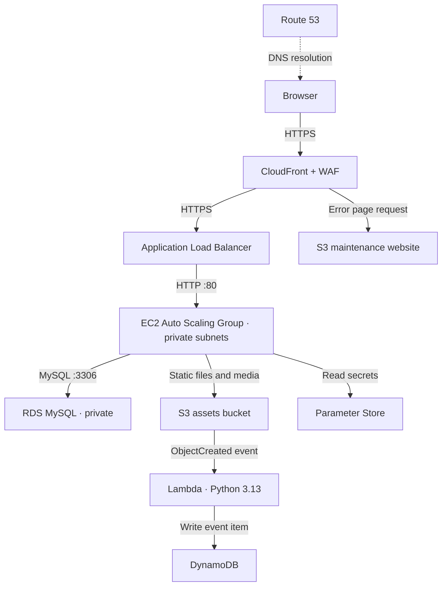
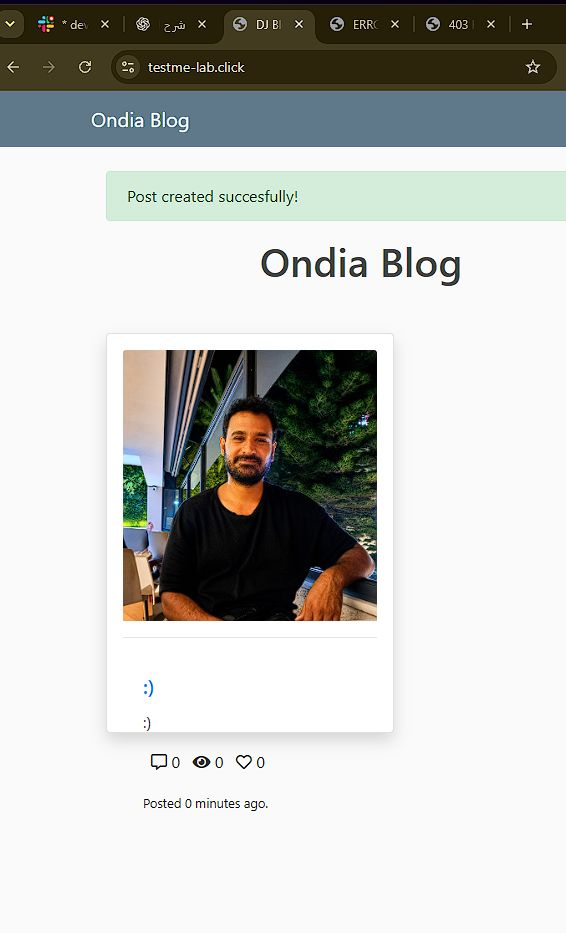
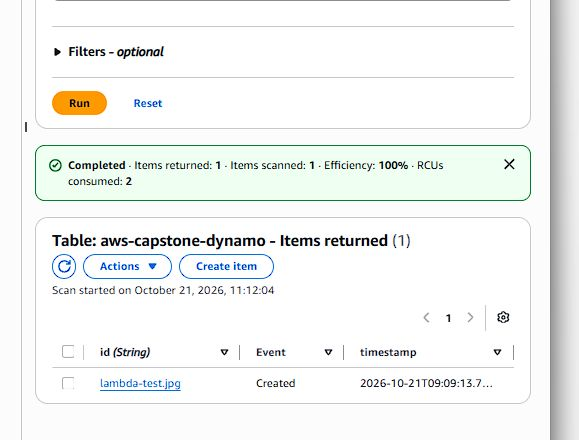

# Django Blog on AWS
### Manual cloud deployment · Yazen Albu

A hands-on AWS capstone deployment of a Django blog with private application instances, an RDS MySQL database, S3 media storage, and event-driven upload tracking.

The application code and assignment were provided by the instructor. My work focused on configuring the AWS infrastructure, deploying the application, troubleshooting integration issues, and documenting the result.

[Deployment notes](DEPLOYMENT.md) · [EC2 bootstrap script](scripts/userdata.sh) · [Original assignment](docs/INSTRUCTOR_ASSIGNMENT.md)

## What I built

| Component | Purpose |
| --- | --- |
| Route 53 and ACM | DNS and HTTPS certificates |
| CloudFront and AWS WAF | Application delivery and request filtering |
| Application Load Balancer | HTTPS listener, HTTP redirect, and target health checks |
| EC2 Auto Scaling Group | Application instances across two private subnets |
| RDS MySQL | Private database for users and blog posts |
| S3 | Static assets, uploaded images, and a separate maintenance website |
| Lambda and DynamoDB | Record S3 object creation events |
| Parameter Store and IAM roles | Retrieve configuration and secrets without embedding credentials |
| VPC, NAT instance, and S3 gateway endpoint | Network isolation and outbound connectivity |

## Architecture



The VPC spans two Availability Zones, each with a public and private subnet. The ALB uses the public subnets; application instances use the private subnets. RDS uses a private DB subnet group and was deployed as a Single-AZ instance.

A NAT instance provides outbound internet access from the private subnets. An S3 gateway endpoint routes S3 traffic through the VPC endpoint.

## Deployment details

- **Region:** us-east-1
- **Application:** Django 5.2 with Gunicorn on Ubuntu 22.04
- **Auto Scaling:** minimum 1, desired 1, maximum 3; CPU target 70%
- **Database:** RDS MySQL, database `ondia`
- **Upload tracking:** Python 3.13 Lambda and DynamoDB table `aws-capstone-dynamo`
- **Test domain:** `testme-lab.click` — used during the lab; continued availability is not guaranteed

Infrastructure was configured manually through the AWS Console. CloudShell and SSH were used for targeted diagnostics and repairs. This repository does not contain a complete infrastructure-as-code deployment.

## Results

### Blog post with an uploaded image

The application displayed **“Post created successfully!”** and rendered the uploaded image after the WAF upload issue was resolved.



### S3 event recorded in DynamoDB

A new S3 upload triggered Lambda and produced an item with the filename, event type, and timestamp. The screenshot shows `lambda-test.jpg` with `Event = Created`.



### Maintenance fallback

A temporary ALB rule returned HTTP 503 on `/capstone-failover-test`. Accessing the same path through CloudFront returned the S3 maintenance page with HTTP 503.

CloudFront is configured to retrieve `/index.html` from the maintenance origin for HTTP 500, 502, 503, and 504 responses. The 503 case was tested. This is **CloudFront custom error handling**, rather than Route 53 DNS failover or an origin group.

## Troubleshooting example: image uploads returned 403

WAF sampled requests identified the blocked request:

```text
POST /create/
Action: BLOCK
Rule: AWSManagedRulesCommonRuleSet / SizeRestrictions_BODY
```

The managed rule blocks request bodies larger than 8 KB. I backed up the Web ACL configuration and overrode **only this rule** to `Count`. Other rules remained in place, and uploading the post with its image then succeeded.

This exception applies to the managed rule group across the distribution, not just the upload path. It is a lab configuration, not a complete production security design.

See [deployment notes](DEPLOYMENT.md) for the other compatibility fixes and deviations from the original assignment.

## Repository guide

| Path | Contents |
| --- | --- |
| `src/` | Django application, templates, and migrations |
| `scripts/userdata.sh` | EC2 bootstrap: dependencies, secrets, migrations, static files, and systemd service |
| `lambda_function.py` | S3 event handler for DynamoDB |
| `S3_Static_Website/` | Maintenance page and image |
| `requirements.txt` | Python dependencies |
| `DEPLOYMENT.md` | Deployment decisions, validation, and troubleshooting |
| `docs/screenshots/` | Screenshots from my deployment |
| `docs/INSTRUCTOR_ASSIGNMENT.md` | Original instructor requirements, preserved unchanged |

## Rebuilding the lab

1. Start with the [original assignment](docs/INSTRUCTOR_ASSIGNMENT.md) and review the [deployment notes](DEPLOYMENT.md) for changes.
2. Configure the VPC, routing, security groups, RDS, S3 buckets, IAM roles, and Parameter Store values.
3. Review the resource names, network ranges, and paths in the application settings and [bootstrap script](scripts/userdata.sh) before using them in another account.
4. Use the bootstrap script with an Ubuntu 22.04 launch template, then configure the ALB and Auto Scaling Group.
5. Configure DNS, certificates, CloudFront, maintenance error responses, and the Lambda-to-DynamoDB integration.
6. Validate the application, uploads, target health, and maintenance response.

The bootstrap script expects the AWS resources and permissions to exist. It is intended for the first boot of a new instance, not repeated execution on an existing installation.

## Scope and cleanup

This is a learning project. Desired capacity 1, a Single-AZ database, and one NAT instance do not provide full multi-AZ availability. Lambda follows the instructor's first-record handler and uses the filename as the DynamoDB key, so duplicate filenames can overwrite an item.

Project resource cleanup was completed on October 21, 2026. The final AWS inventory returned no project EC2 instances, Auto Scaling groups, load balancers, target groups, RDS databases or manual snapshots, CloudFront distributions, Lambda functions, S3 buckets, DynamoDB tables, IAM roles, launch templates, SNS topics, alarms, log groups, SSM parameters, network interfaces, Elastic IPs, or ACM certificates within the checked scope. The project VPC and WAF ACL were also confirmed absent, and the CloudFront pricing subscription was cancelled.

The application is now offline. The registered domain, hosted zone, shared key pair, and GitHub repository were preserved. Screenshots retain the deployment results.

Do not commit `.env` files, private keys, passwords, or access tokens.

## Credits

Based on the instructor-provided Ondia/Clarusway AWS capstone assignment and Django application. AWS deployment, troubleshooting, and implementation documentation by **Yazen Albu**.

[GitHub](https://github.com/yazenAlbu) · [LinkedIn](https://www.linkedin.com/in/yazen-albu)
